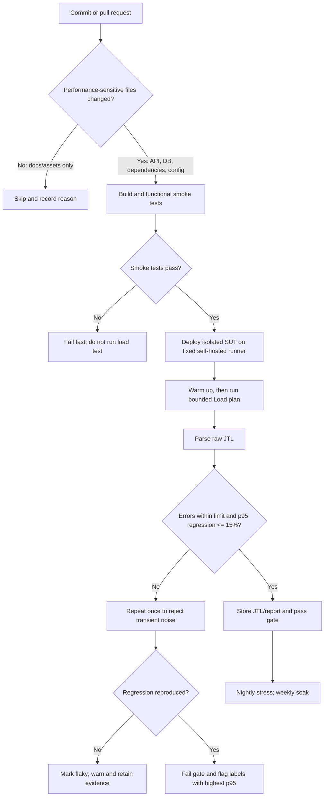

# Continuous Performance Testing proposal

## Goal

Detect meaningful p95 latency regressions close to the commit that introduced them, while avoiding the cost and noise of running the full performance suite for every documentation-only change.

## Decision flow

## Trigger policy

- Pull request: run a short load gate only when backend routes, database schema/queries, dependencies, runtime configuration, or test plans change.
- Merge to main: run the same load gate and update the accepted baseline only after review.
- Nightly: run Stress to find saturation changes.
- Weekly/on release: run Spike and the 12-minute Soak plan on an otherwise idle, fixed machine.
- Manual dispatch: allow investigation with an explicit commit and scenario, never an arbitrary public target.

## Gate and baseline

The analyzer reads the raw CSV JTL and calculates nearest-rank percentiles. An initial policy is:

- error rate no greater than 1%;
- overall p95 no greater than the agreed service objective;
- p95 regression no greater than 15% versus the median of recent accepted runs;
- fail only after the regression reproduces once on the same runner.

The 1% and 15% values are starting governance thresholds, not claims about current SUT performance. Replace the absolute p95 objective only after measuring the clean baseline on controlled hardware. Keep the baseline JTL, commit SHA, machine identity, JMeter version, and scenario parameters together.

## Controlling noise and false alarms

- Use a dedicated self-hosted runner with fixed CPU/RAM, power mode, Java/JMeter versions, and no concurrent jobs.
- Reset the database and backend process for every run, warm up before measurement, and retain raw JTLs.
- Compare the same endpoint labels and workload shape. Never compare a changed thread count or CSV mix to the old baseline without marking a baseline migration.
- Retry once only for diagnosis. Unlimited retries hide real regressions.
- Monitor runner CPU/memory; invalidate a run if unrelated contention is observed.

## Trade-offs

Frequent testing shortens feedback time but consumes runner time and grows the order database. Path filtering and a short pull-request gate reduce cost, while nightly/weekly schedules preserve deeper coverage. A fixed runner improves comparability but costs more and can become a bottleneck. A strict single-run gate catches regressions quickly but creates false alarms from OS scheduling, JIT warm-up, SQLite state, or network noise; a controlled rerun reduces false positives at the cost of slower feedback. Storing every JTL improves auditability but requires retention limits. Finally, p95 alone can hide low-frequency tail failures, so p99, error rate, throughput, and per-label results remain review signals even when only p95 blocks the merge.

